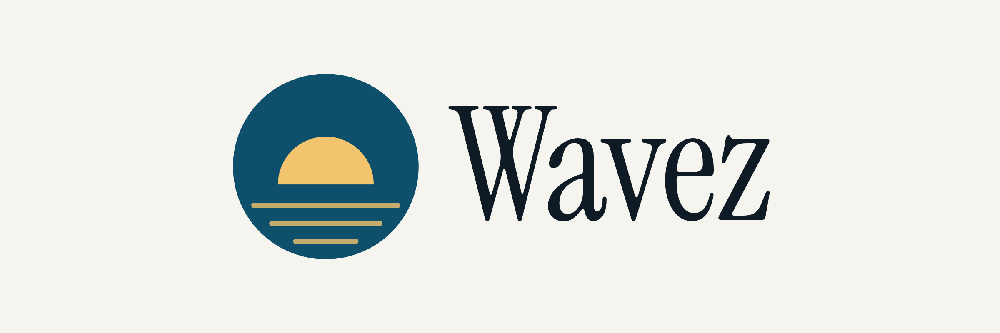
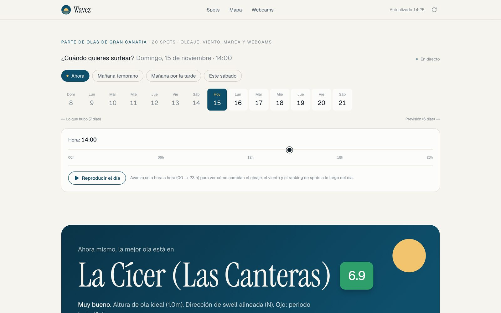
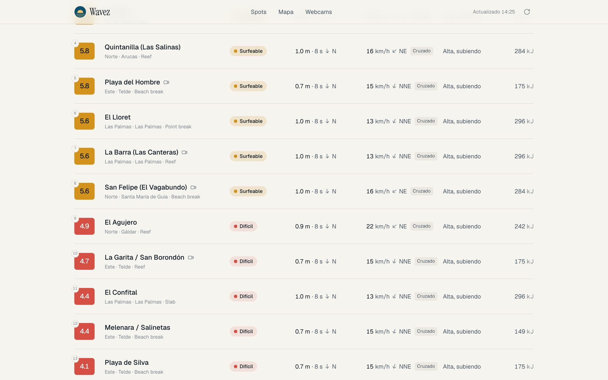
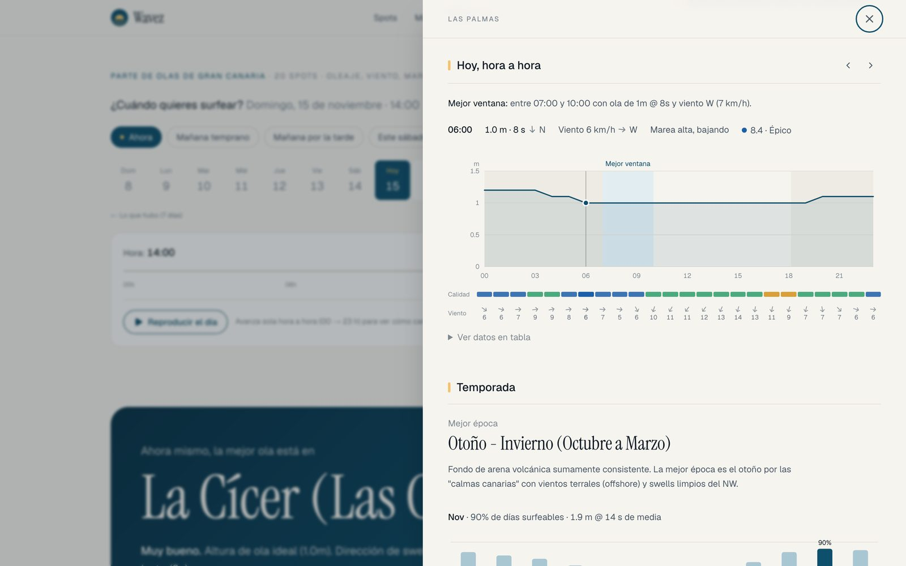
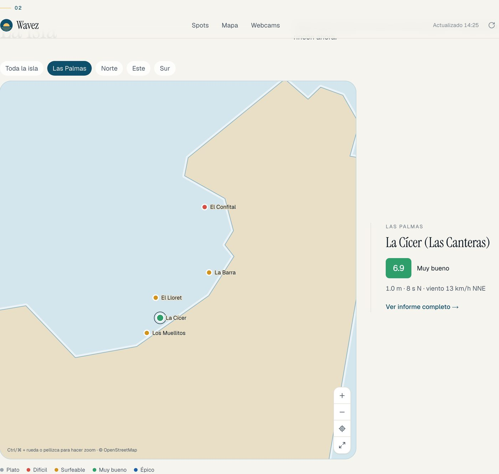
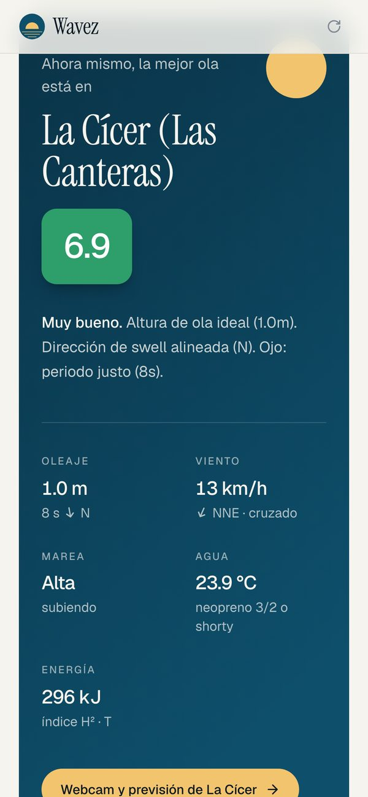
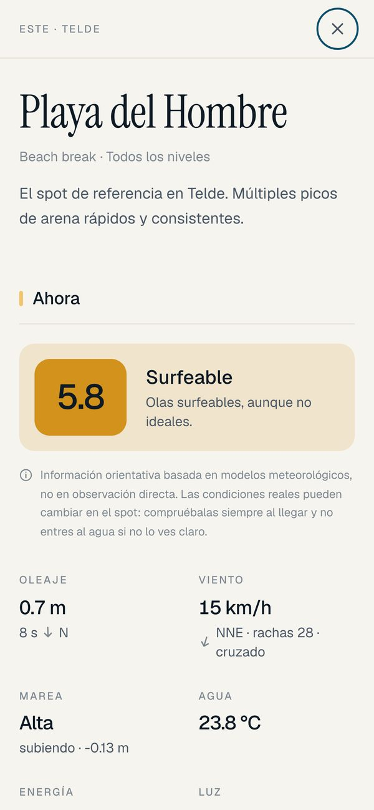
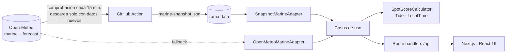

<p align="center">
  
</p>

<p align="center">
  <strong>El parte de olas de Canarias.</strong><br>
  66 spots en las 7 islas · oleaje, viento, marea y 31 webcams, hora a hora · gratis y abierto
</p>

<p align="center">
  <a href="https://wavez-pi.vercel.app"><strong>🌊 Abrir Wavez</strong></a> ·
  <a href="https://wavez-pi.vercel.app/wavez-metodologia.pdf">📄 Metodología (PDF)</a> ·
  <a href="#decisiones-técnicas">⚙️ Decisiones técnicas</a>
</p>

<p align="center">
  
</p>

## Qué es

Wavez responde a una pregunta: **¿dónde y cuándo merece la pena surfear hoy en Canarias?**

Para cada spot de las siete islas combina modelos oceánicos y meteorológicos abiertos con la ficha del spot (qué tamaño aguanta, qué swell le entra, qué viento es terral, qué marea prefiere) y lo resume en una **nota de 0 a 10** que explica sus pros y contras. Se puede mirar cualquier hora de los últimos 7 días y de los próximos 6, ver la mejor ventana del día, la temporada de cada pico y sus webcams en directo.

| | |
|---|---|
|  |  |
| **Ranking** de los spots con la nota del momento elegido. | **El día hora a hora**: altura, calidad, viento, marea y mejor ventana. |
|  | <p align="center"> </p> |
| **Mapa** con la costa real (OpenStreetMap), zoom y pantalla completa. | Diseñado primero para el **móvil**, que es donde se consulta en la playa. |

## Funcionalidades

- **Toda Canarias y una página por isla**: la portada abre con el archipiélago dibujado en su posición real, cada isla teñida con el color de su mejor ola; se elige isla tocándola. Cada isla (`/tenerife`, `/lanzarote`…) muestra qué costa funciona, todos sus spots, su mapa y sus webcams.
- **Hoy para ti**: el mejor spot ahora para quien aprende, para nivel intermedio, para avanzados y el de menos viento, solo entre spots pensados para ese nivel.
- **Nota 0–10 explicada**: oleaje y dirección (40), viento (35), periodo (25) y ajuste por marea. Un mar plato nunca puntúa como bueno.
- **Línea temporal de 15 días** en hora canaria, con atajos ("mañana temprano", "este sábado") y reproducción hora a hora del día.
- **Informe por spot** enlazable (`/gran-canaria?spot=la-cicer`): ahora, webcam, por qué esa nota, el día hora a hora, temporada y ficha.
- **Marea, temperatura del agua y luz real** (orto/ocaso) para calcular la mejor ventana.
- **31 webcams**: 14 de In2theBeach que se ven dentro de Wavez (cargadas bajo demanda y de una en una) y 17 de SkylineWebcams, que no permite insertarlas y se abren en su web. Cada cámara indica si enfoca el spot o una playa cercana.
- **Fotos de la comunidad verificadas**: solo cámara en vivo y con la ubicación del móvil dentro del spot.
- **SEO**: contenido renderizado en servidor, páginas estáticas por isla y por spot (`/spots/<spot>`), sitemap, Open Graph y datos estructurados.

## Decisiones técnicas

Lo más interesante del proyecto no es la interfaz, sino los problemas de datos que hubo que resolver. El [informe de metodología](https://wavez-pi.vercel.app/wavez-metodologia.pdf) los explica en detalle con las fórmulas; aquí va el resumen:

- **Leer el mar en el lado correcto de la isla.** Open-Meteo devuelve la celda oceánica válida más cercana, y las celdas costeras están enmascaradas. Para Las Canteras eso era una celda ~15 km al **este** de Las Palmas, en la otra cara de La Isleta. Cada spot puede declarar un *punto marino* en mar abierto frente a su ventana de swell; el viento se sigue leyendo en la playa.
- **Nunca inventar datos.** Los valores nulos del modelo se descartaban con valores por defecto (1 m, 10 s…). Ahora esas horas se omiten y el spot se marca "sin datos".
- **Hora canaria en todas partes.** Open-Meteo da horas locales sin zona horaria; parsearlas con `new Date()` las desplazaba según el servidor o el navegador. Todo se compara como cadenas locales.
- **Topes en la nota.** Sumar puntos de forma independiente hacía que 0,3 m con calma y periodo largo saliera "Muy bueno". El mar plato y el oleaje por debajo del mínimo del spot tienen tope.
- **Una descarga para todos, solo cuando hay datos nuevos.** Una GitHub Action se lanza cada 15 min, descarga un spot de prueba y lo compara con el JSON publicado en la rama `data`. Open-Meteo solo cambia su respuesta cuando un modelo publica un pase nuevo (cada 3 a 12 h), así que la mayoría de las veces no hay nada nuevo y se vuelve a publicar lo mismo marcado como comprobado. Cuando cambia, descarga todos los spots en **2 peticiones** (Open-Meteo admite varias coordenadas). Cada 6 h se fuerza una descarga completa por seguridad. Los visitantes nunca consultan Open-Meteo: la web muestra esa instantánea, que cubre 15 días hora a hora, e indica cuándo se comprobó por última vez. Solo si no se puede leer recurre a Open-Meteo en directo como emergencia.
- **Spots validados.** Un test comprueba que cada spot está a menos de 1,5 km de la costa de su isla, que su punto marino cae en el mar y que su zona pertenece a su isla. Las costas se generan desde OpenStreetMap con `scripts/build-coasts.ts`.
- **Seguridad.** Cabeceras CSP, `frame-ancestors 'none'` y Permissions-Policy; parámetros de URL validados contra el catálogo antes de usarse; JSON-LD escapado; 404 reales para islas y spots inexistentes.
- **Energía calculada, no scrapeada.** Índice `40·H²·T`, proporcional a la potencia de ola en aguas profundas `P = ρg²H²T/64π`.
- **Gráficas legibles**: un único eje por gráfica, paleta de calidad validada para daltonismo y siempre acompañada de texto, navegación por teclado y vista en tabla.

## Arquitectura

Arquitectura hexagonal (puertos y adaptadores): la lógica de surf no sabe nada de Next.js ni de Open-Meteo.



```
src/
├── domain/          # Modelos, puertos y servicios puros: nota, marea, hora local, validación de fotos
├── application/     # Casos de uso y composition root (container.ts)
├── infrastructure/  # Open-Meteo (directo e instantánea), catálogo de spots por isla, rate limiting
├── presentation/    # Componentes de la web, gráficas SVG propias, formato
└── app/             # Rutas de Next.js: portada, /[island], /spots/[slug], API, sitemap, robots, OG
scripts/             # Instantánea de datos (GitHub Action) y generación de costas desde OpenStreetMap
docs/metodologia/    # Fuente HTML del informe PDF
```

**Stack:** Next.js 16 (App Router, Cache Components) · React 19 · TypeScript estricto · Tailwind CSS 4 · tests con el runner nativo de Node · Vercel · GitHub Actions.

## Ejecutar en local

```bash
npm install
npm test          # tests de dominio, casos de uso y adaptadores
npm run dev       # http://localhost:3000
```

Variables opcionales:

| Variable | Para qué |
|---|---|
| `NEXT_PUBLIC_SITE_URL` | URL canónica para SEO (en Vercel se usa la de producción automáticamente). |
| `MARINE_SNAPSHOT_URL` | Otra ubicación para la instantánea de datos. |
| `SUPABASE_URL` / `SUPABASE_SECRET_KEY` | Almacén de las fotos de la comunidad. Sin ellas, las fotos se guardan solo en memoria (útil en local). |

### Fotos de la comunidad (Supabase)

1. Ejecuta [`supabase/migrations/20261115000000_spot_reports.sql`](supabase/migrations/20261115000000_spot_reports.sql) en el *SQL Editor* de tu proyecto.
2. Copia `.env.example` a `.env.local` y rellena la URL y la clave secreta (*Project Settings → API Keys*).
3. Pon las mismas variables en Vercel y vuelve a desplegar.

Las fotos van a un bucket público `spot-photos`; los datos, a la tabla `spot_reports` (RLS activado, sin políticas públicas: solo el servidor accede). Se guardan 48 h, como máximo 12 por spot, y cada persona puede subir 5 cada 10 minutos (contado en la base de datos con un hash de la IP). No se guarda la ubicación de quien sube la foto, solo su distancia al spot.

La instantánea se puede generar a mano con `npx tsx scripts/refresh-marine-snapshot.ts out/marine-snapshot.json [instantánea-anterior.json]` o lanzando el workflow *Refresh marine data* desde la pestaña *Actions*.

### Añadir un spot o una isla

Los spots están en `src/infrastructure/spots/<isla>.ts`; las islas y sus zonas, en `src/domain/models/Island.ts`; las webcams, en `src/infrastructure/webcams.ts`. Para una isla nueva hay que añadir su caja en `scripts/build-coasts.ts`, generar la costa y registrarla en `islandGeometry.ts`. `npm test` comprueba que todo encaja.

## Datos y créditos

- Oleaje, viento, marea y temperatura: [Open-Meteo](https://open-meteo.com/) (CC BY 4.0).
- Costa de las islas: © [OpenStreetMap](https://www.openstreetmap.org/copyright) (ODbL).
- Webcams: [In2theBeach](https://in2thebeach.es/) y [SkylineWebcams](https://www.skylinewebcams.com/), propiedad de sus autores.

> Wavez es orientativo: muestra datos de modelos, no observaciones. Las condiciones reales pueden cambiar en el spot; compruébalas siempre al llegar.
